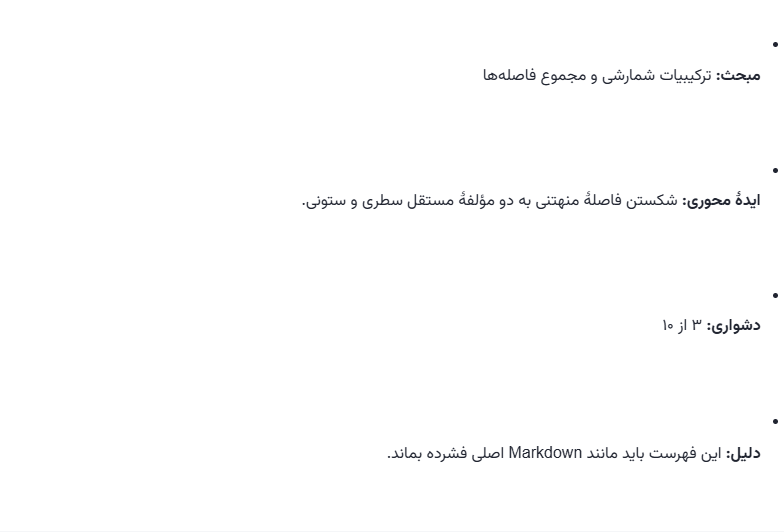

# Parsify v0.1.9 — Fix inherited whitespace in ChatGPT lists

Extension version: **1.3.5**.

## What changed

The previous margin fixes did not solve the reported gaps. Shadow DOM isolates
selectors, but still inherits CSS properties. When a ChatGPT response ancestor
preserves whitespace, the newlines between our generated `ul`, `li` and `p`
tags become visible line boxes. Bullets appear above their text and each row
grows several lines tall, even when margins are zero.

The ChatGPT shadow reader now explicitly uses `white-space: normal`. Fenced code
retains its explicit `pre` rule and Markdown hard breaks retain their `br`
elements. Fonts, math rendering and native interactive components are unchanged.

## Evidence and validation

- Reproduced the screenshot's separated bullets and excessive gaps in Chromium
  using the released renderer and a host with `white-space: pre-wrap`.
- The same four-row fixture grew from **135 px to 530 px** before this fix.
  It now stays **135 px**, with each bullet and paragraph on the same line.
- The fixture's verifier now checks actual list-row geometry, code indentation
  and explicit line breaks. Reinstating whitespace inheritance makes it fail;
  restoring this fix makes it pass.
- Checked desktop (1280 px) and mobile (412 px) widths under `normal`,
  `pre-wrap`, `pre-line` and `break-spaces`. All eight combinations passed.
- Visually checked Persian bold labels, wrapped mobile rows, inline math and
  nested lists.
- All 190 automated tests passed. Chrome and Firefox builds passed. Firefox
  lint reported zero errors and the same ten existing static-analysis warnings.
- Live-tab inspection was attempted but the local browser and Windows
  automation runtimes failed to initialize. This release was verified in a
  controlled browser reproduction, not in the user's live logged-in tab.

Before (synthetic fixture):

After:

## Install

- Chrome: extract `Parsify-v0.1.9-chrome-extension.zip`, load that folder in
  `chrome://extensions`, confirm version **1.3.5**, and refresh ChatGPT.
- Firefox: the XPI and temporary ZIP contain the same fix. The XPI is unsigned;
  permanent standard Firefox installation still requires Mozilla signing.
- Windows and Android builds are unchanged.
